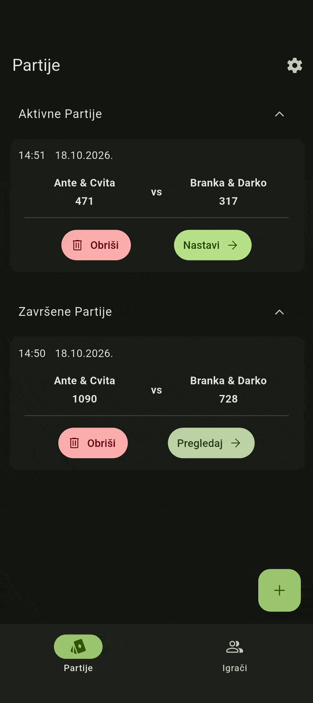
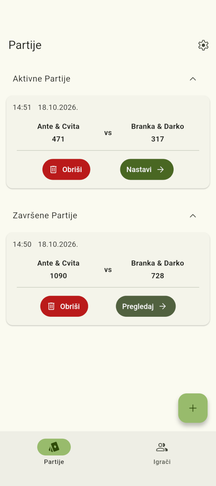
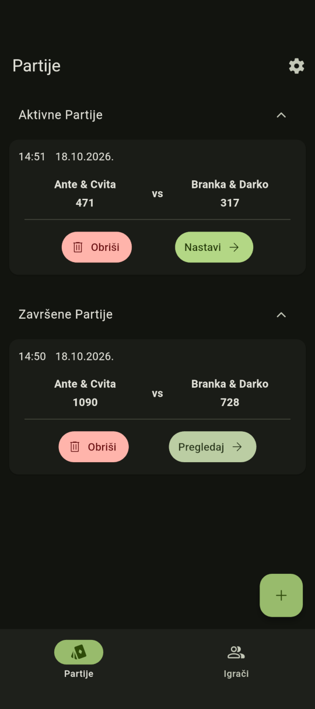
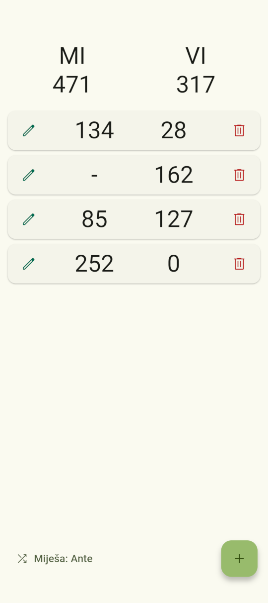
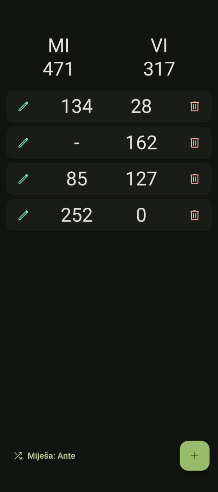
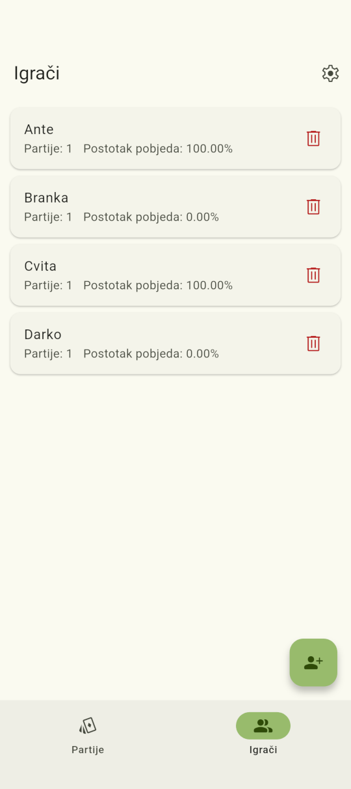
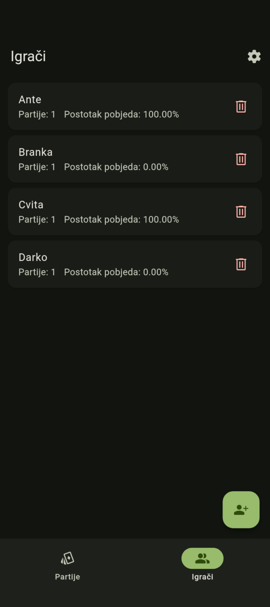

<div align="center">


# Bela Blok

Moderan digitalni blok za praćenje rezultata u kartaškoj igri Bela.

[](https://flutter.dev)
[](https://dart.dev)
[](https://android.com)
[](https://sqlite.org)

</div>

---

## 📸 Prikaz sučelja

### Demo

<p align="center">
  
</p>

### Svijetla / Tamna Tema

<p align="center">
  
  &nbsp;
  
</p>

<p align="center">
  
  &nbsp;
  
</p>

<p align="center">
  
  &nbsp;
  
</p>

---

## ✨ Značajke

- **Brzo i precizno upisivanje bodova**: Automatsko izračunavanje bodova za drugi par uz ugrađeni kalkulator i provjeru zvanja.
- **Podrška za varijante igre**: Biranje broja bodova do kuda se igra, smjera igranja i tko prvi miješa.
- **Pohrana i povijest**: Ugrađena SQLite baza podataka čuva sve vaše odigrane runde, aktivne i završene partije izravno na uređaju bez potrebe za internetom.
- **Moderan Material 3 dizajn**: Suvremeno korisničko sučelje s prirodnim animacijama, podrškom za dinamičke teme te svijetlim i tamnim načinom rada.

---

## 🏗️ Arhitektura projekta

Ovaj projekt je strukturiran za skalabilnost i čist kod:

- **Modeli (`/lib/models`)**: Povezuju UI s bazom podataka s pomoću modela podataka za partiju, rundu, zvanje i igrača.
- **Baza podataka (`/lib/database`)**: Koristi `sqflite` za lokalno i sigurno spremanje partija, igrača i povijesti rundi.
- **Ekrani (`/lib/screens`) i Widgeti (`/lib/widgets`)**: Ekrani su razbijeni na modularne i ponovno iskoristive komponente (dijalozi za unos i brisanje, kartice za prikaz igrača, partija i rundi) čime su ostali čisti i pregledni.
- **Preference (`/lib/services/app_preferences.dart`)**: Preference korisnika se spremaju lokalno (odabir svijetle/tamne teme, smjer igranja, tko prvi miješa) kako bi aplikacija pamtila postavke pri svakom pokretanju.

---

## 📥 Preuzimanje i instalacija

### Izravno preuzimanje (APK)

Preuzmite najnoviju verziju aplikacije izravno za vaš Android uređaj:

[](https://github.com/vujnovicmarko/bela_blok/releases/latest)

- 📱 **[Izravno preuzimanje APK datoteke](https://github.com/vujnovicmarko/bela_blok/releases/latest/download/app-release.apk)**

### Provjera integriteta

Kako biste bili sigurni da preuzeta datoteka nije oštećena, možete usporediti SHA-1 otisak vaše datoteke s objavljenom `.sha1` datotekom iz izdanja:

```bash
# macOS / Linux
shasum -a 1 -c app-release.apk.sha1

# Windows PowerShell
(Get-FileHash app-release.apk -Algorithm SHA1).Hash
```

---

### Kompajliranje iz izvornog koda

```bash
# Klonirajte repozitorij
git clone [https://github.com/vujnovicmarko/bela_blok.git](https://github.com/vujnovicmarko/bela_blok.git)

# Uđite u direktorij
cd bela_blok

# Preuzmite ovisnosti
flutter pub get

# Izradite Android APK
flutter build apk --release
```
